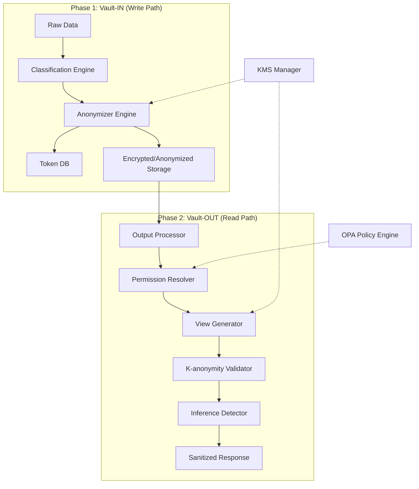

# Bastion-Vault Design Document

## 1. Introduction
Bastion-Vault is Module B of the Bastion RAG Security Governance Framework. It serves as the authoritative layer for data privacy, isolation, and anonymization. Vault ensures that sensitive information is protected during storage (Phase 1) and that access is strictly controlled and dynamically sanitized during retrieval (Phase 2).

### 1.1 Core Objectives
- **Multi-Tenancy Isolation:** Cryptographic and logical separation of data between tenants.
- **Deterministic Anonymization:** Consistent transformation of PII to maintain searchability while ensuring privacy.
- **Dynamic Access Control:** Department-based RBAC enforced via Open Policy Agent (OPA).
- **Privacy Enforcement:** K-anonymity validation and inference attack detection on all data outputs.

---

## 2. System Architecture

Vault employs a **Two-Phase Security Model** to provide defense-in-depth across the entire data lifecycle.

### 2.1 Two-Phase Security Model

1.  **Vault-IN (Phase 1):** Processes data before storage. It detects PII, classifies data into categories (Customer, Manufacturing, HR/Finance), and applies anonymization strategies.
2.  **Vault-OUT (Phase 2):** Processes data during retrieval. It evaluates the requester's permissions via OPA, selectively deanonymizes tokens, applies K-anonymity generalizations, and detects potential inference attacks.

---

## 3. Core Components

### 3.1 Classification Engine (`internal/classification`)
Identifies sensitive data fields and assigns them to one of three categories:
- **DC-01 (Customer):** High sensitivity, strict PIPA/GDPR compliance.
- **DC-02 (Manufacturing):** Medium sensitivity, focus on IP protection.
- **DC-03 (HR/Finance):** Very high sensitivity, internal privacy focus.

### 3.2 Anonymizer Engine (`internal/anonymizer`)
Executes transformation strategies based on data type and sensitivity:
- **Deterministic Tokenization:** Reversible mapping (e.g., "Hong Gildong" -> "KR_NAME_8f3d2a").
- **HMAC-SHA256:** Irreversible hashing for identifiers like RRN/SSN.
- **Format Preserving Encryption (FPE):** Preserves structure (e.g., email/credit card) while encrypting.
- **Partial Masking:** "010-****-5678".

### 3.3 Access Controller (`internal/access`)
Integrates with **Open Policy Agent (OPA)** to provide fine-grained, department-based RBAC.
- **Access Levels:** Full, Read, Anonymized, K-anonymized, Slice, and Aggregated.
- **Slice Access:** Context-limited access (e.g., Manufacturing accessing only product-related customer claims).

### 3.4 K-anonymity Validator (`internal/kanon`)
Ensures that any released data set meets privacy requirements.
- Groups results by quasi-identifiers (age, region, etc.).
- Automatically applies **Generalization Hierarchy** (e.g., "32" -> "30-34" -> "30s") if the group size is smaller than the target 'K' value.

### 3.5 Output Processor (`internal/output`)
The heart of Vault-OUT, coordinating several sub-components:
- **Permission Resolver:** Maps user roles to effective access levels.
- **View Generator:** Creates the sanitized version of the data.
- **Inference Detector:** Tracks query history to prevent re-identification through combined query results.

### 3.6 KMS Manager (`internal/kms`)
Provides a unified abstraction for multiple Key Management Services:
- **Supported Providers:** AWS KMS, HashiCorp Vault, and Local (Dev).
- **Key Hierarchy:** Master Key (KEK) -> Tenant Key (TK) -> Data Encryption Key (DEK).

---

## 4. Data Flow

### 4.1 Write Path (Vault-IN)
1.  **Request:** Client sends raw data with `tenant_id` and optional `category`.
2.  **Detection:** Classification engine identifies PII types (Name, Email, RRN).
3.  **Anonymization:** Anonymizer requests a DEK from KMS, transforms PII, and stores reversible mappings in the Token DB.
4.  **Storage:** The sanitized record is stored in the tenant-isolated database.

### 4.2 Read Path (Vault-OUT)
1.  **Request:** A user/system requests data with their security context (Role, Department).
2.  **Authorization:** Access Controller queries OPA to determine the allowed `Access Level`.
3.  **Retrieval:** Data is fetched from storage (still in its Phase 1 anonymized state).
4.  **Processing:**
    - If `Full` access: Tokens are resolved via Token DB + KMS.
    - If `K-anonymized` access: View Generator applies generalizations; K-anon Validator verifies group sizes.
5.  **Inference Check:** Detector calculates risk score based on recent query history.
6.  **Response:** Final sanitized data is returned to the requester.

---

## 5. Security & Compliance

- **Multi-Tenancy:** Isolation enforced via logical separation (tenant_id) and cryptographic isolation (per-tenant keys).
- **Audit Logging (`internal/audit`):** Every access decision, anonymization, and deanonymization event is logged and forwarded to Module D (Tracker).
- **Break-Glass (`internal/breakglass`):** Emergency access mechanism with dual-approval workflow and time-bounded permissions.
- **Compliance:** Designed to meet PIPA (South Korea), GDPR (EU), and PCI DSS standards.

---

## 6. Technical Stack

- **Language:** Go 1.21+
- **Policy Engine:** Open Policy Agent (OPA)
- **Database:** PostgreSQL (Token DB & Primary Storage)
- **Cache:** Redis (Query History & Permissions)
- **Communication:** gRPC (Internal), REST (External)
- **Observability:** Prometheus Metrics & Structured Logging
